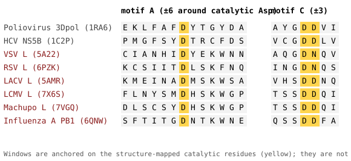

# Rdrp Motif Search

<!-- Auto-generated draft from CLI metadata for `rolypoly rdrp-motif-search`. -->
<!-- Expand this page with command-specific context, examples, and citations. -->

## Summary

Search for RdRp motifs (A, B, C, D) in nucleotide or amino acid sequences.

## Description

This command searches input sequences for RNA-dependent RNA polymerase (RdRp)
motif patterns using pre-built profile databases from the RVMT project.

The output is a table with one row per input sequence, showing motif locations,
scores, and conformations found.

## Usage

```bash
rolypoly rdrp-motif-search [OPTIONS]
```

<!-- BEGIN GENERATED CLI OPTIONS -->
## Options

- `-i`, `--input`: Input FASTA file with nucleotide or amino acid sequences (type: `TEXT`; required; default: `Sentinel.UNSET`)
- `-o`, `--output`: Output directory path (type: `TEXT`; default: `./rdrp_motif_search_output`)
- `-e`, `--evalue`: E-value threshold for motif searches (type: `FLOAT`; default: `0.01`)
- `--min-score`: Minimum score threshold for motif matches (type: `FLOAT`)
- `--max-distance`: Maximum distance between motifs in amino acids (type: `INTEGER`; default: `250`)
- `--search-tool`: No description provided. (type: `CHOICE`; default: `hmmsearch`)
- `--aa-method`: Method for amino acid translation from nucleotides (type: `CHOICE`; default: `six_frame`)
- `--min-orf-length`: Minimum ORF length for gene prediction (type: `INTEGER`; default: `30`)
- `--motif-filter`: Filter results by specific motif type (type: `CHOICE`)
- `--no-include-alignment`: Disable including aligned region sequences in output (alignment included by default) (type: `BOOLEAN`; default: `False`)
- `--data-dir`: Path to rolypoly data directory (if not in default location) (type: `TEXT`)
- `--output-format`: Output file format (tsv or parquet) (type: `CHOICE`; default: `tsv`)
- `--output-structure`: Output structure: nested (motif_details as JSON) or flat (separate columns per motif) (type: `CHOICE`; default: `nested`)
- `-ow`, `--overwrite`: Overwrite output directory if it exists (type: `BOOLEAN`; default: `False`)
- `-cf`, `--config-file`: JSON config file with parameters (overrides command line) (type: `TEXT`)
- `-t`, `--threads`: Number of worker threads. (type: `INTEGER RANGE`; default: `1`)
- `-M`, `--memory`: Memory limit, for example 8g. (type: `MEMORY`; default: `8g`)
- `-k`, `--keep-tmp`: Keep temporary files. (type: `BOOLEAN`; default: `False`)
- `-td`, `-tmp`, `--temp-dir`: Temporary working directory. (type: `DIRECTORY`)
- `-g`, `--log-file`: Path to the log file. (type: `FILE`; default: `rolypoly.log`)
<!-- END GENERATED CLI OPTIONS -->

## Caveats

### Non-classical motif A and the Arena/influenza anchors

Motif A in positive-strand RdRps is usually a pair of Asp residues,
`D-x(4,5)-D`. In the negative-strand polymerases (PROSITE profiles PS50525
and PS50526), only one conserved Asp lies upstream of motif C and the second
Asp is absent. It does pass the structural test, and the cached structure
analysis puts it within 8 Å of the first motif C Asp in every structure
examined:

| Structure | Virus | Motif A Asp | Motif C | A Asp to first C Asp (side chain, Cα) |
| --- | --- | --- | --- | --- |
| 1RA6 | Poliovirus 3Dpol (positive-strand, for comparison) | D233, D238 | D328-D329 (GDD) | 7.1 Å (7.9 Å) |
| 1C2P | HCV NS5B (positive-strand, for comparison) | D220, D225 | D318-D319 (GDD) | 5.7 Å (7.8 Å) |
| 5A22 | Vesicular stomatitis virus L | D605 | D714-N715 (GDN) | 4.6 Å (6.9 Å) |
| 6PZK | Respiratory syncytial virus L | D700 | D811-N812 (GDN) | 5.1 Å (5.7 Å) |
| 5AMR | La Crosse virus L | D1060 | D1187-D1188 (SDD) | 5.0 Å |
| 7X6S | Lymphocytic choriomeningitis virus L | D1182 | D1321-D1322 (SDD) | 6.8 Å (6.7 Å) |
| 7VGQ | Machupo virus L | D1188 | D1329-D1330 (SDD) | 3.7 Å (6.4 Å) |
| 6QNW | Influenza A PB1 | D305 | D445-D446 (SDD) | 3.9 Å |

Distances are the minimum side-chain atom distance (Cα–Cα in parentheses
where recorded) from the structure analysis, not a metal-coordination test.
Residue numbers are structure numbering, mapped to UniProt sequences with
letter checks; the LCMV, Machupo, VSV, RSV and influenza motif A numbers rest
on structure geometry and alignment, whereas the La Crosse motif
`1060-DMSKWS` and motif C `SDD` are stated in the original structure paper.
The structure resolutions of several of these (cryo-EM, 3–4 Å) leave
side-chain positions uncertain.



The figure shows short windows centred on the catalytic residues of each
protein. They are **not an alignment**: windows are cut at the structure-mapped
catalytic Asp and are not gap-aligned. Two features stand out. The positive-strand
polymerases carry the second Asp five residues downstream (`D-x4-D`), while in the
negative-strand polymerases the single Asp is followed instead by a short
`D-x-[S/E/T]-K-W/F` stretch (`DMSKWS`, `DHSKWG`, `DYEKWN`, `DLSKFN`; influenza
`DNTKWN`), with no second Asp. Motif C is `GDD` in the positive-strand examples,
`GDN` in the non-segmented negative-strand viruses and `SDD` in the segmented
ones.

**How RolyPoly treats it.** A lone conserved Asp that satisfies conservation and
juxtaposition, but not `D-x(4,5)-D`, is a *single-Asp motif A*. The next data bundle
labels it as motif A with an explicit single-Asp qualifier in its source label,
and it will be kept distinct from `D-x(4,5)-D` motif A rows. The Arena
(`Arena_RNA_pol`) and influenza (`Flu_PB1`) Pfam profiles have no source-qualified
anchor other than this single Asp and motif C, and rely on structures
independent of the VSV L and La Crosse L anchors used for the other negative-strand
profiles. Data bundles that predate these rows (including the current public bundle)
carry no projected labels for those two profiles; they remain detection-only.

This is a statement about where a catalytic residue sits, not an exact
motif boundary. Projected extents are wider than the residues that define the
motif, and extents have not been validated against truth. Do not use the
presence or absence of a second Asp to call a polymerase non-functional,
split, or non-RdRp. Motif C context residues beyond the `GDN`/`SDD` triplet are
not invariant: the fourth `GDNQ` position is `E` in Hendra virus.

**References.**

- *Structural insights into bunyavirus replication and its regulation by the vRNA promoter* (2015) *Cell*,
  [doi:10.1016/j.cell.2015.05.006](https://doi.org/10.1016/j.cell.2015.05.006).
- *Structure of the L protein of vesicular stomatitis virus from electron cryomicroscopy* (2015) *Cell*,
  [doi:10.1016/j.cell.2015.06.018](https://doi.org/10.1016/j.cell.2015.06.018).
- *Functional analysis of conserved motifs in influenza virus PB1 protein* (2012) *PLoS ONE*,
  [doi:10.1371/journal.pone.0036113](https://doi.org/10.1371/journal.pone.0036113).
- *Structures of influenza A virus RNA polymerase offer insight into viral genome replication* (2019) *Nature*,
  [doi:10.1038/s41586-019-1530-7](https://doi.org/10.1038/s41586-019-1530-7).
- *Structure basis for allosteric regulation of LCMV polymerase function by Z matrix protein* (7X6S):
  [doi:10.1093/procel/pwad018](https://doi.org/10.1093/procel/pwad018).
- *Structure of Machupo virus polymerase in complex with matrix protein Z* (7VGQ):
  [doi:10.1038/s41467-021-26432-3](https://doi.org/10.1038/s41467-021-26432-3).
- *The exceptionally large genome of Hendra virus* (`GDNE` in motif C context, 2000):
  [doi:10.1128/JVI.74.21.9972-9979.2000](https://doi.org/10.1128/JVI.74.21.9972-9979.2000).
- PROSITE profiles PS50507, PS50525 and PS50526 and documentation PDOC50507
  ([prosite.expasy.org](https://prosite.expasy.org/PDOC50507)), used only as a
  labelling source (CC BY-NC-ND 4.0). No PROSITE alignment is redistributed.

## Additional Notes

```text
EXAMPLES:

  # Basic search with default nested TSV output and alignment
  rolypoly rdrp-motif-search -i sequences.fasta -o results_dir

  # Flat structure with separate motif columns
  rolypoly rdrp-motif-search -i sequences.fasta -o results_dir --output-structure flat

  # Parquet output with structured data for analysis
  rolypoly rdrp-motif-search -i sequences.fasta -o results_dir --output-format parquet

  # Disable alignment to reduce output size
  rolypoly rdrp-motif-search -i sequences.fasta -o results_dir --no-include-alignment

  # High sensitivity search with custom parameters
  rolypoly rdrp-motif-search -i sequences.fasta -o results_dir -e 0.1 --max-distance 300

OUTPUT FORMATS:

  flat + tsv: separate columns (motif_a_start, motif_b_start, etc.)
  nested + tsv: motif_details column as JSON string - DEFAULT
  flat + parquet: separate columns with native data types
  nested + parquet: motif_details as structured data types
```
