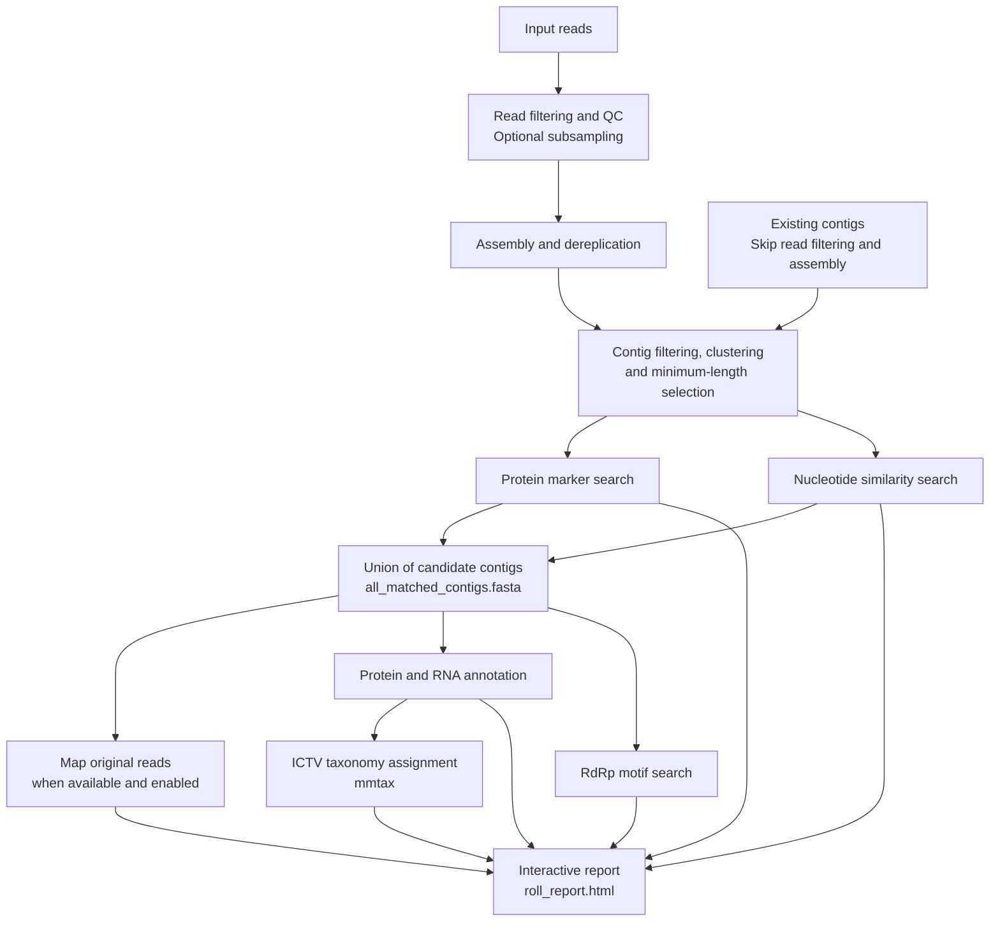

# Roll

<!-- Auto-generated draft from CLI metadata for `rolypoly roll`. -->
<!-- Expand this page with command-specific context, examples, and citations. -->

## Summary

End-to-end pipeline for RNA virus discovery from raw sequencing data.

## Description

The pipeline follows these stages, subject to the selected preset and skipped steps:

1. Filter reads and perform quality control, with optional subsampling.
2. Assemble reads into contigs and dereplicate the assembly unless disabled.
3. Filter contigs against a supplied host reference, optionally screen rRNA.
4. Cluster contigs, then independently apply the minimum-length cutoff.
5. Search for protein markers and nucleotide matches to identify candidate viral contigs.
6. Combine candidates from either search into `all_matched_contigs.fasta`.
7. Map the original reads to the selected contigs, unless mapping is disabled.
8. Annotate proteins and RNAs on the candidate contigs.
9. Search for RdRp motifs.
10. Assign ICTV taxonomy with `mmtax`, unless the taxonomy step is skipped.
11. Generate the interactive `roll_report.html`, unless reporting is disabled.

Virus-characteristic prediction is planned but is not implemented.

### Library policy and explicit overrides

`-mlp` / `--multi-lib-pol` / `--multilibrarypolicy` is passed to `filter-reads`:
`keep-separate` (default), `single-output`, or `pre-concatenate`.
See [Filter Reads](filter_reads.md#multiple-libraries) for processing differences,
output names, and the input-to-output library manifest. `assemble` discovers
the resulting libraries by their filenames and uses backend-native file lists
or datasets; `roll` does not force output collapse just because an assembler
models one logical library.

Mini mode and fast roll, filter, or assembly presets select `pre-concatenate`
even when a different policy was requested, and log that choice. Mini mode
passes **all** sampled libraries into filtering, not just the first pair.
Subsampling still operates per input library before their concatenation.

Explicit `--assembler` takes precedence over the assembly preset, including
the default `rna_virus` preset and mini mode's `fast` preset. Explicit
`--no-rmdup` also survives preset application. For example:

```bash
rolypoly roll -i raw_reads/sample_1 -o results/sample_1 \
  --assembler megahit --multi-lib-pol keep-separate
```

This requests MEGAHIT only, with independently preprocessed libraries.
Preset-specific per-tool parameters still apply to the selected assembler.

### Default read filtering

Default `roll` (`--preset rna_virus`) and default standalone `filter-reads`
use the same `rna_virus_metat` filtering preset, automatic-tuning policy,
and `keep-separate` library policy. With the same input, references, overrides,
and resource settings, they select the same filtering parameters and steps.
Quality trimming uses `trimq=5`, `minlen=25`; adapter trimming uses `minlen=20`.
These preset parameters are protected from automatic tuning. Poly(A) trimming
and synthetic-artifact removal remain disabled by default.

Standalone filtering formerly used unprotected automatic quality tuning.
Use `filter-reads --preset auto` (or `roll --filter-preset auto`) to retain
that behavior. Changing defaults does not invalidate old cached results:
`--skip-existing` does not compare every filtering parameter.

For other roll presets, select the corresponding standalone presets:

| Roll preset | Filter Reads preset | Assemble preset |
| --- | --- | --- |
| `rna_virus` (default) | `rna_virus_metat` (default) | `rna_virus` |
| `ribodepleted` | `total_rna_ribodepleted` | `rna_virus` |
| `poly_a` | `poly_a_selected` | `metatranscriptome` |
| `all_virus_metat` | `all_virus_metat` | `rna_virus` |
| `DNA_virus` | `all_virus_metag` | `metag` |
| `complete` | `rna_virus_metat` | `complete` |
| `fast` | `fast` | `fast` |

`roll --preset fast` also subsamples reads and narrows search databases;
standalone `filter-reads --preset fast` does not subsample. Explicit
`--filter-preset` and `--assembly-preset` replace the mapped choices.

## Staging large or uneven datasets across machines

Prefer one raw-input folder and one result folder per sample. This lets you
schedule unusually complex samples separately without rerunning completed
stages for the others. Read filtering, assembly, and MMseqs-backed `mmtax`
can benefit from high-memory servers/nodes. Marker searches and annotation
can benefit from CPU-rich nodes or PCs when their databases and memory needs
fit. These are scheduling recommendations, not measured resource guarantees;
requirements depend on sample complexity, backend, and database size.
Set `--memory` and `--threads` separately for each invocation.

### Standalone filtering, then roll

On the filtering node, write directly into the layout expected by roll:

```bash
rolypoly filter-reads -i /shared/raw/sample_1 \
  -o /shared/results/sample_1/filtered_reads --threads 16 --memory 64g
```

Then, on the next machine:

```bash
rolypoly roll --skip-existing -i /shared/raw/sample_1 \
  -o /shared/results/sample_1 --threads 32 --memory 32g
```

No new handoff format or conversion is needed. **Roll's input is still the
original raw-read folder**, not the filtered-read folder. Its output is the
**parent** of the standalone filtering output. Roll checks the completed
`filtered_reads/run_info/libraries.tsv` manifest, reuses the published
libraries, assembles them, and keeps the original reads available for mapping.
Keep all published FASTQs and `run_info/`; do not use `--zip-reports` for
automatic reuse. Match the multi-library policy and any nondefault presets
or host-reference choices (standalone `--known-dna` corresponds to roll `--host`).
Do not use `--overwrite`, which would remove the roll output tree.

### Alternatively, run only filtering through roll

To keep roll's preset selection and output layout from the start, skip every
stage after filtering. This works in a fresh output directory without an
assembly:

```bash
rolypoly roll -i /shared/raw/sample_1 -o /shared/results/sample_1 \
  --threads 16 --memory 64g \
  --skip-steps assemble,filter_contigs,cluster,length_filter,marker_search,nucleic_search,map_reads,annotate,rdrp_motif_search,taxonomy,report
```

This exits successfully after publishing filtered reads and metadata, with
the usual temporary cleanup (unless `--keep-tmp` is supplied). Later, omit
that skip list and resume:

```bash
rolypoly roll --skip-existing -i /shared/raw/sample_1 \
  -o /shared/results/sample_1 --threads 32 --memory 32g
```

Use the same presets, references, and library policy in both invocations.
The default does not subsample. With `--mini` or `--preset fast`, add
`subsample` to the skip list if you want to filter the original reads instead
of a subset; the remaining mini/fast preset choices still apply.
The same path and metadata requirements as standalone filtering apply.

### Transferring completed results

Automatic filtering reuse requires the same absolute input and output paths,
so shared storage mounted at the same location is simplest. When transferring
results, copy the complete sample result tree and retain the raw inputs.
Dereference symlinks during a changed-path transfer (for example,
`rsync -aL /old/results/sample_1/ /new/results/sample_1/`): assembly and
downstream FASTA outputs can be absolute symlinks into the old tree.
Moving those links unchanged would leave broken outputs after the old
location becomes unavailable.
If paths change, after verifying that filtering completed and the transferred
files are the intended libraries, explicitly bypass filtering:

```bash
rolypoly roll --skip-existing --skip-steps filter_reads \
  -i /new/raw/sample_1 -o /new/results/sample_1 --threads 32 --memory 32g
```

This is a deliberate handoff, not manifest validation: it trusts
`/new/results/sample_1/filtered_reads`. Merely pointing ordinary roll at
filtered FASTQs would filter them again. If the original reads are unavailable,
do not substitute the filtered reads and claim raw-read mapping equivalence.

### Also offload assembly

Run assembly on a memory-rich node using the same result tree and preset:

```bash
rolypoly assemble --input-dir /shared/results/sample_1/filtered_reads \
  --preset rna_virus -o /shared/results/sample_1/assembly \
  --threads 16 --memory 128g
rolypoly roll --skip-existing -i /shared/raw/sample_1 \
  -o /shared/results/sample_1 --threads 32 --memory 32g
```

Roll reuses `assembly/final_assembly.fasta` and continues downstream.
Transfer the complete assembly directory, including identifier mappings and
metadata, rather than only the FASTA. Use the table above for nondefault
assembly presets; standalone `assemble` does not default to `rna_virus`.

### Also offload taxonomy

Taxonomy now defaults to DIAMOND for all presets, including fast/mini.
Use `--taxonomy-backend mmseqs` to choose the previous backend. DIAMOND
does not enforce `--memory`; MMseqs2 receives a split-memory budget after
reserving the larger of 5% or 1 GiB, not a hard process RAM cap.
See [mmtax memory behavior and local baselines](mmtax.md#memory-behavior).

On the CPU-rich machine, run roll with `--skip-steps taxonomy,report`.
After candidate discovery and annotation finish, run standalone `mmtax`
on the memory-rich node. For the default annotated output:

```bash
mkdir -p /shared/results/sample_1/taxonomy
rolypoly mmtax -i /shared/results/sample_1/all_matched_contigs.fasta \
  --proteins /shared/results/sample_1/annotation_results/protein_annotation/predicted_orfs.faa \
  --protein-gff /shared/results/sample_1/annotation_results/protein_annotation/predicted_orfs.gff \
  -o /shared/results/sample_1/taxonomy/mmtax.tsv \
  --database ncbi_virus --backend diamond --sensitivity normal \
  --threads 16 --memory 64g
rolypoly roll --skip-existing -i /shared/raw/sample_1 \
  -o /shared/results/sample_1 --threads 32 --memory 32g
```

Reuse the same taxonomy backend/database/sensitivity as the intended roll run.
If annotation was skipped, omit the protein options so `mmtax` predicts
proteins itself; only run this stage when candidate contigs exist.
The last roll invocation reuses the taxonomy table and creates the deferred
report. If a report already exists, `--skip-existing` will not refresh it.

Only hand off successfully completed stages. Filtering validates its library
manifest, but other roll stages generally reuse expected files or directories
by existence, not by validating parameters or partial-run completeness.
After changing scientific settings, use a new result directory rather than
assuming `--skip-existing` will detect the change. These handoffs are tested
with small fixtures; production-scale performance still needs benchmarking.

## Selecting workflow steps

`--skip-steps` accepts a comma-separated list using underscores, not CLI
command hyphens. Unknown names are rejected before processing.

| Step string | Effect when skipped |
| --- | --- |
| `subsample` | In mini/fast mode, filter original reads instead of a subset. Other mini/fast settings remain active. |
| `filter_reads` | Use existing `<output>/filtered_reads` for assembly; no filtering-manifest validation is performed. |
| `assemble` | Require existing `<output>/assembly/final_assembly.fasta`, except for filtering-only runs or contigs-input mode. |
| `filter_contigs` | Pass current contigs through without host/rRNA filtering. |
| `cluster` | Pass current contigs through without clustering. |
| `length_filter` | Pass current contigs through without the `--min-len` cutoff. |
| `marker_search` | Do not search or use cached protein-marker hits. |
| `nucleic_search` | Do not search or use cached nucleotide hits. |
| `map_reads` | Do not map original reads or compress existing mapping outputs. |
| `annotate` | Do not run annotation. Taxonomy can predict proteins when annotation proteins are unavailable. |
| `rdrp_motif_search` | Do not search for RdRp motifs. |
| `taxonomy` | Do not run `mmtax`. |
| `report` | Do not generate a report. |

`filter_contigs`, `cluster`, and `length_filter` are independent transformations.
An explicit skip bypasses the transformation **and its cached result**, even
with `--skip-existing`; downstream steps receive the current upstream contigs.
Existing skipped-stage files remain untouched. When reusing downstream results,
remember that their settings/input provenance is not comprehensively checked:
use a new output directory if changing transformations should trigger new searches.

Skipping both `filter_reads` and `assemble` selects contigs-input mode:
`-i` must be a contig FASTA, identifiers are normalized with a mapping, and
mapping reads is automatically skipped. Skipping only assembly normally
requires an existing assembly; it does not mean “stop after filtering.”
The filtering-only exception requires **every** stage from `assemble` through
`report` to appear in the skip list shown above.

When both discovery searches are skipped, current contigs become the input
for downstream steps. If active searches find no candidates, downstream
processing is skipped automatically. Combining search candidates, maintaining
identifier mappings, preparing directories, and cleanup are required workflow
plumbing, not independently skippable scientific steps. Assembly dereplication
already has `--no-rmdup`; mapping compression has `--compression-policy none`.
For finer read-cleaning or annotation controls, use the standalone commands.

## Workflow



Arrows show data flow, not parallel execution. Marker and nucleotide searches
are executed sequentially. Taxonomy can use annotation proteins when available
or predict proteins itself. Presets and database options determine which
searches and tools are used; consult the options below for current defaults.

If neither search identifies candidates, downstream mapping, annotation,
motif search, taxonomy and reporting are skipped. If both candidate-search
steps are explicitly skipped, the final assembly is used as the downstream
input instead. See [Report](report.md) for interpreting the output and its
[known limitations](report.md#caveats).

## Usage

```bash
rolypoly roll [OPTIONS]
```

### Reducing mapping storage

```bash
rolypoly roll -i raw_reads/sample_1 -o results/sample_1 \
  --compression-policy sam_only
```

`-cp` / `--compression-policy` uses the existing `pigz` executable and the
requested thread count to losslessly write read-mapping SAMs as `.sam.gz`:

- `sam_only` (default): gzip every final read-mapping SAM, for every mapper.
- `none`: write new mapping outputs as plain SAM.

The size-dependent `over_10gb` policy has been removed.

Headers, alignments, sequences, qualities, tags, and any unmapped records are
preserved byte-for-byte on decompression. Originals are removed only after
compression succeeds; existing `.sam.gz` destinations are never overwritten.
With `--skip-existing`, the policy also applies to existing read-mapping SAMs
without remapping. Already compressed files are left alone; `none` does not
decompress them. Explicitly skipping mapping leaves mapping outputs untouched.

New read-mapping SAMs **retain both mates if either maps**. Unmapped single
reads and fully unmapped pairs (including flags 77 and 141) are omitted;
half-mapped pairs and secondary/supplementary alignments remain.
This deliberately removes fully unmapped templates before compression;
gzip itself is lossless. Use `--include-unmapped` to also retain fully unmapped
reads/pairs with BBMap, BWA-MEM2, and minimap2/mappy.
MMseqs searches reads independently and emits only hits, so it cannot retain
unmapped mates; the command logs this limitation.
See [Map](map.md) for backend details. Reusing mapping with `--skip-existing`
does **not** refilter old SAMs; compression preserves those existing files.

This policy only affects read-mapping SAMs, not assemblies, filtered reads,
search results, or reports. `--keep-tmp` controls temporary cleanup, not these
retained outputs. To avoid mapping storage altogether, use `--mapper none`
or `--skip-steps map_reads` when alignments are unnecessary. Other retained
outputs are not automatically deleted or archived because they can be used
for resuming and downstream analysis.

BWA-MEM2 streams SAM stdout through the template/pair filters into `pigz`.
Minimap2/mappy generates records directly into `pigz`, and BBMap uses native
gzip output. These backends do not write a plain SAM intermediate.
MMseqs still writes a SAM before gzip: `easy-search` tries to open
`/dev/stdout.0` when given `/dev/stdout`, so a direct stdout pipeline is not
supported by the installed version. It therefore temporarily needs space
for both the original SAM and its gzip output, as does compression of
resumed plain SAMs. See [Map](map.md#lossless-sam-compression) for backend
details and optional pair-filter behavior.

This is not a SAM-to-BAM/CRAM implementation, and production-scale compression
ratios and performance have not been benchmarked.

<!-- BEGIN GENERATED CLI OPTIONS -->
## Options

- `-i`, `--input`: Input path to raw RNA-seq data (fastq/gz file or directory with fastq/gz files). To reuse standalone filter-reads, keep this original input and write filtered reads to <output-dir>/filtered_reads, then use --skip-existing. (type: `TEXT`; required; default: `Sentinel.UNSET`)
- `-o`, `--output-dir`: Output directory (type: `TEXT`; default: `/home/neri/Documents/GitHub/rps/rolypoly_rp_e2e`)
- `-D`, `--host`: Path to the user-supplied host/contamination fasta /// Fasta file of known DNA entities expected in the sample. If not provided some steps will be skippted. (type: `TEXT`)
- `--preset`: Preset that selects both a filter-reads and an assemble preset suited to the library type. 'rna_virus': RNA virus metatranscriptome (default): rRNA removal (mincovfraction=0.6), host + identified-DNA filtering, no polyA trim; rnaviralSPAdes+MEGAHIT assembly 'ribodepleted': Total-RNA that went through ribo-depletion: residual rRNA filtering (mincovfraction=0.6, same as rna_virus), host + identified-DNA filtering, no polyA trim; rnaviralSPAdes+MEGAHIT assembly 'poly_a': Poly-A selected mRNA: polyA tail trimming (trimpolya=18), stricter quality trim (trimq=12); rnaSPAdes+MEGAHIT assembly 'all_virus_metat': All-virus metatranscriptome / RNA virome: more aggressive rRNA removal (mincovfraction=0.5, versus default 0.6), skips identified-DNA filter; rnaviralSPAdes+MEGAHIT assembly 'DNA_virus': DNA virome / metagenomics: skips rRNA and identified-DNA filtering entirely; metaSPAdes only 'complete': Expansive: rna_virus_metat read filtering + all three assemblers (metaSPAdes+rnaviralSPAdes+MEGAHIT) 'fast': Quick preview / mini mode: subsamples reads, skips error correction and identified-DNA filter; MEGAHIT only with narrow k-mer range; narrowed marker/nucleic/annotation databases (type: `CHOICE`; default: `rna_virus`)
- `--filter-preset`: Override the read-filtering preset chosen by --preset. (type: `CHOICE`)
- `--assembly-preset`: Override the assembly preset chosen by --preset. (type: `CHOICE`)
- `-mlp`, `--multi-lib-pol`, `--multilibrarypolicy`: Read-library policy passed to filter-reads: pre-concatenate, keep-separate, or single-output. Fast presets and mini mode select pre-concatenate. (type: `CHOICE`; default: `keep-separate`)
- `--mini`: Enable mini mode for quick testing. This will subsample the input reads and use a faster assembly preset. (type: `BOOLEAN`; default: `False`)
- `-sz`, `--sample-size`: Total reads (>1) OR proportion (0-1) of total reads to be used by --mini subsampling. NOTE: this is ignored if --mini-subset-type is set to bbnorm (type: `INTEGER`; default: `50000`)
- `-ml`, `--min-len`, `--minimum-length`: Contigs shorter than this will not be used during virus identification (i.e. in marker search OR nucleic search) (type: `INTEGER`; default: `200`)
- `-mst`, `--mini-subset-type`: Subset type used if --mini is set. note: first is quicker than random which is quicker than bbnorm, but bbnorm is the only one that might be useful in a non 'quick and dirty' attempt. 'first' assumes your input isn't sorted by anything. (type: `CHOICE`; default: `random`)
- `--skip-existing`: Skip commands if output files already exist (type: `BOOLEAN`; default: `False`)
- `-ow`, `--overwrite`: Overwrite roll output directory if it already exists (type: `BOOLEAN`; default: `False`)
- `-A`, `--assembler`: Assembler choice (spades,spades_rnaviral,megahit,penguin). For multiple, give a comma-separated list. An explicit choice overrides the assembly preset. (type: `TEXT`; default: `spades,megahit`)
- `--no-rmdup`: Disable default assembly dereplication before downstream analysis. (type: `BOOLEAN`; default: `False`)
- `-m`, `--mapper`: Mapper backend(s) for standalone read mapping. Use multiple -m flags for multiple mappers. select 'none' to skip mapping. (type: `CHOICE`; default: `bbmap`)
- `--include-unmapped`: Also retain fully unmapped reads/pairs where supported. By default, retain both mates if either maps; resumed outputs are not refiltered. (type: `BOOLEAN`; default: `False`)
- `-cp`, `--compression-policy`: Read-mapping SAM compression: sam_only (gzip, default) or none (plain SAM). Other outputs are unchanged. (type: `CHOICE`; default: `sam_only`)
- `--cluster-backend`: ANI backend for contig clustering. Use 'none' to skip clustering entirely. (type: `CHOICE`; default: `linclust`)
- `--cluster-method`: Clustering method passed to the cluster command. (type: `CHOICE`; default: `centroid`)
- `--cluster-min-identity`: Minimum identity threshold for clustering. (type: `FLOAT`; default: `99.0`)
- `--cluster-min-target-coverage`: Minimum target coverage threshold for clustering. (type: `FLOAT`; default: `99.0`)
- `--cluster-min-query-coverage`: Minimum query coverage threshold for clustering. (type: `FLOAT`; default: `0.0`)
- `--cluster-min-alignment-fraction`: Minimum min(query,target) coverage threshold for clustering. (type: `FLOAT`; default: `0.0`)
- `--cluster-mmseqs-sensitivity`: MMseqs sensitivity when cluster backend uses mmseqs. (type: `FLOAT`; default: `7.5`)
- `-Fm1`, `--filter1_nuc`: First set of rules for nucleic filtering by aligned stats (type: `TEXT`; default: `alnlen >= 120 & pident>=75`)
- `-Fm2`, `--filter2_nuc`: Second set of rules for nucleic match filtering (type: `TEXT`; default: `qcov >= 0.95 & pident>=95`)
- `-Fd1`, `--filter1_aa`: First set of rules for amino (protein) match filtering (type: `TEXT`; default: `length >= 80 & pident>=75`)
- `-Fd2`, `--filter2_aa`: Second set of rules for protein match filtering (out potential host/contamination sequences) (type: `TEXT`; default: `qcovhsp >= 95 & pident>=80`)
- `--dont-mask`: If set, host fasta won't be masked for potential RNA virus-like seqs (type: `BOOLEAN`; default: `False`)
- `--mmseqs-args`: Additional arguments to pass to MMseqs2 search command during filtering of potential host/contamination sequences (type: `TEXT`; default: `--min-seq-id 0.5 --min-aln-len 80`)
- `--diamond-args`: Additional arguments to pass to Diamond search command during filtering of potential host/contamination sequences (type: `TEXT`; default: `--id 50 --min-orf 50`)
- `--skip-steps`: Comma-separated steps to skip: subsample,filter_reads,assemble,filter_contigs,cluster,length_filter,marker_search,nucleic_search,map_reads,annotate,rdrp_motif_search,taxonomy,report. Skipping all steps from assemble through report runs filtering only. Skipping both filter_reads and assemble treats input as contigs and skips mapping. Otherwise, skipping assemble requires an existing assembly. Skipped filter_contigs, cluster and length_filter pass through the current contigs and ignore cached outputs. subsample only applies to mini/fast mode. (type: `TEXT`)
- `--dbm`, `--db-marker`: Database(s) to use for marker gene search (type: `TEXT`; default: `rvmt,genomad,Pfam_RTs_RdRp`)
- `--dbn`, `--db-nucleic`: Database(s) to use for nucleic acid search (type: `TEXT`; default: `all`)
- `--dba`, `--db-annotation`: Database(s) to use for protein annotation. (type: `TEXT`; default: `all`)
- `-txb`, `--taxonomy-backend`: Taxonomy search backend for all presets, including fast/mini. DIAMOND does not enforce --memory. (type: `CHOICE`; default: `diamond`)
- `-txd`, `--taxonomy-db`: Built-in mmtax database name or custom backend database path. (type: `TEXT`; default: `ncbi_virus`)
- `-txt`, `--taxonomy-taxdump`: Taxdump required when --taxonomy-db is a custom path. (type: `DIRECTORY`)
- `-txs`, `--taxonomy-sensitivity`: Shared mmtax sensitivity preset or level 1-8. (type: `TEXT`; default: `normal`)
- `--report`, `--no-report`: Write an interactive HTML roll report (roll_report.html) from the annotation results (marker/protein hits + RNA track) at the end of the run. (type: `BOOLEAN`; default: `True`)
- `--report-best-by`: Initial 'best hit per range' criterion shown in the report (toggleable in the viewer). (type: `CHOICE`; default: `score`)
- `--filter-flag-only`: Retain host/rRNA matches in filter-contigs and record warning intervals. (type: `BOOLEAN`; default: `False`)
- `--filter-rrna`: Opt in to early rRNA screening in filter-contigs; otherwise use annotate-rna evidence. (type: `BOOLEAN`; default: `False`)
- `-t`, `--threads`: Number of worker threads. (type: `INTEGER RANGE`; default: `1`)
- `-M`, `--memory`: Memory limit, for example 8g. (type: `MEMORY`; default: `8g`)
- `-k`, `--keep-tmp`: Keep temporary files. (type: `BOOLEAN`; default: `False`)
- `-tmp`, `--temp-dir`: Temporary working directory. (type: `DIRECTORY`)
- `-g`, `--log-file`: Path to the log file. (type: `FILE`; default: `rolypoly.log`)
<!-- END GENERATED CLI OPTIONS -->


## Contig QC and flag-only mode

`roll` normally removes host-matched contigs when `--host` is supplied.
`--filter-flag-only` retains those matches and passes their warning intervals
to the report. `--filter-rrna` optionally enables early rRNA screening, even
without `--host`; it is off by default. When enabled, predominantly rRNA contigs
are removed unless flag-only is selected. Localized rRNA hits are retained and
flagged. See [filter-contigs](filter_contigs.md#optional-early-rrna-screening).

Without early screening, the report uses rRNA hits from annotate-rna's Rfam
search; it does not launch another rRNA search. If both evidence sources exist,
covered matching rRNA features share a red warning feature. Host nucleotide
and protein warnings also appear in the RNA/QC track and feature table.
